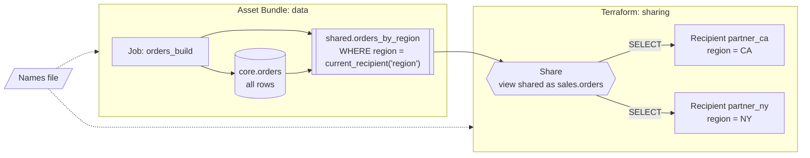

# Row-level filtering for OpenSharing recipients with Databricks Asset Bundles and Terraform

This repository shows how to share one table with many open sharing (token)
recipients so that each recipient reads only its own rows, and how to keep
object names consistent when a Databricks Asset Bundle creates the data and
Terraform manages the sharing.

It contains two independent, deployable examples that solve the naming problem
in different ways:


|                         | [Approach 1: bundle variables file](approach-1-bundle-variables/)           | [Approach 2: flat config file](approach-2-flat-config/)                        |
| ----------------------- | --------------------------------------------------------------------------- | ------------------------------------------------------------------------------ |
| Source of truth         | `config/names.yml`, written as bundle `variables` with per-target overrides | `config/<target>.yml`, plain `key: value` pairs                                |
| How the bundle reads it | `include` in `databricks.yml`                                               | `BUNDLE_VAR_<key>` environment variables set by `scripts/deploy.sh`            |
| How Terraform reads it  | `yamldecode(file(...))` in `infra/main.tf`                                  | `TF_VAR_<key>` environment variables set by `scripts/deploy.sh`                |
| Extra tooling           | None                                                                        | [`yq`](https://github.com/mikefarah/yq) v4                                     |
| Safety net              | Terraform fails on an unknown target                                        | Neither tool has defaults, so running either one without the config file fails |
| Choose it when          | Bundle and Terraform live in one repository                                 | The file must stay tool-neutral, or other tools also read it                   |


Both approaches deploy the same objects and can run side by side in one
workspace: their names differ (`opensharing_ex1_*` and `opensharing_ex2_*`),
and so do the share and recipient names of each target, because shares and
recipients are unique per metastore.

## What gets deployed




| Object                              | Owner             | Notes                                                                                           |
| ----------------------------------- | ----------------- | ----------------------------------------------------------------------------------------------- |
| Schemas `*_core` and `*_shared`     | Bundle            | The core schema is never shared                                                                 |
| Base table `orders`                 | Bundle (job task) | 1,000 synthetic rows, 250 per region `CA`, `NY`, `TX`, `WA`. Stands in for your pipeline output |
| View `orders_by_region`             | Bundle (job task) | Filters rows with `current_recipient('region')`                                                 |
| Recipients, their `region` property | Terraform         | Token-based (open sharing)                                                                      |
| Share and `SELECT` grants           | Terraform         | The view is shared as `sales.orders`                                                            |


Each object has exactly one owner. Asset Bundles do not support shares or
recipients as resources
([bundle resources](https://docs.databricks.com/gcp/en/dev-tools/bundles/resources)),
so Terraform manages those.

## Why a dynamic view instead of row filters

- **Row filters and column masks cannot protect data from open sharing
recipients.** "OpenSharing providers cannot share tables with table-level
row filters or column masks"
([row filters and column masks, limitations](https://docs.databricks.com/gcp/en/data-governance/unity-catalog/filters-and-masks)).
Tables secured by ABAC policies can be shared only if the share owner is
exempt from the policy, and then "the policy doesn't govern the recipient's
access"
([ABAC requirements](https://docs.databricks.com/gcp/en/data-governance/unity-catalog/abac/requirements)).
- **A dynamic view filters per recipient.** `current_recipient('<key>')`
returns a property of the recipient that runs the query
([current_recipient](https://docs.databricks.com/gcp/en/sql/language-manual/functions/current_recipient)).
One view and one share serve all recipients; each recipient sees only rows
matching its own property
([recipient properties](https://docs.databricks.com/gcp/en/opensharing/manage-recipients)).
- **A copy per recipient also works**, but you then maintain and refresh one
table per recipient.

## Prerequisites

- A Unity Catalog workspace with serverless compute enabled.
- An existing catalog. Both examples default to `main`; change it in the names
file before deploying.
- Privileges for the deploying identity:
  - `CREATE SHARE`, `CREATE RECIPIENT` and `SET SHARE PERMISSION` on the metastore
  - `USE CATALOG` and `CREATE SCHEMA` on the catalog
- [Databricks CLI](https://docs.databricks.com/gcp/en/dev-tools/cli/install)
and [Terraform](https://developer.hashicorp.com/terraform/install) 1.5 or later.
- For approach 2: [`yq`](https://github.com/mikefarah/yq) v4.
- For testing as a recipient: Python 3.10 or later.

Both tools use [Databricks unified authentication](https://docs.databricks.com/gcp/en/dev-tools/auth/unified-auth).
The simplest setup is a CLI profile that both read:

```bash
databricks auth login --host https://<workspace-url> --profile my-workspace
export DATABRICKS_CONFIG_PROFILE=my-workspace
```


## Quick start

```bash
cd approach-1-bundle-variables          # or approach-2-flat-config
# set `catalog` in config/names.yml (approach 1) or config/dev.yml (approach 2)
# set recipient names and regions in infra/env/dev.tfvars
scripts/deploy.sh dev
```

`deploy.sh` runs the two tools in dependency order:

1. `databricks bundle deploy`, then `databricks bundle run orders_build`, which
  creates the base table and the view.
2. `terraform apply`, which creates the recipients, the share and the grants.
  Terraform looks up the view first and stops if it does not exist.

Each target gets its own Terraform workspace, so `dev` and `prod` keep separate
state. Terraform asks for confirmation before applying; set `AUTO_APPROVE=1` to
skip the prompts in CI (any other value keeps them).

## Test as a recipient

You cannot query the view as the provider: `current_recipient()` only evaluates
in a sharing context, and a provider query fails with
`DELTA_SHARING_CURRENT_RECIPIENT_PROPERTY_UNDEFINED`. Test it as a recipient:

1. Get the activation links. They are credentials; handle them as secrets.
  ```bash
   terraform -chdir=infra output -json activation_urls
  ```
2. Open a link in a browser and download the credential file. Each link
  works only once
   ([read data shared with bearer tokens](https://docs.databricks.com/gcp/en/opensharing/read-data-open)).
3. Read the share with that credential and check the filter:
  ```bash
   python -m venv .venv && .venv/bin/pip install -r tools/requirements.txt
   .venv/bin/python tools/verify_share.py partner_ca.share \
       --table opensharing_ex1_orders.sales.orders --expect-region CA
  ```
   The script prints the tables the recipient can see and the row count per
   region, and exits non-zero unless every row has the expected region.


## Rename the base table

This is the scenario the shared names file exists for. Recipients query the
view, under its `shared_as` name, so the base table can change without
touching the share:

1. Change `orders_table` in the names file, for example to `orders_v2`.
2. Run `scripts/deploy.sh dev`. The job writes `orders_v2` and updates the
  view to read from it. `terraform apply` reports no changes; the share and
   the recipients are untouched.
3. Drop the old table once you no longer need it. Nothing in this example drops
  it for you.

If you share a table directly instead of a view, a rename changes the shared
object, and recipients see a different name unless `shared_as` is set. Set
`shared_as` once: changing it makes Terraform recreate the share object.

## Things to know

- **Update shared views with** `ALTER VIEW`**, not** `CREATE OR REPLACE VIEW`**.** A
view that is in a share cannot be dropped, and `CREATE OR REPLACE VIEW`
fails with `DELTA_SHARING_SECURABLE_DELETE_BLOCKED`. The view task creates
the view on the first run and updates it with `ALTER VIEW ... AS` afterwards
([ALTER VIEW](https://docs.databricks.com/gcp/en/sql/language-manual/sql-ref-syntax-ddl-alter-view)).
- **Rebuild the base table in one statement.** The example uses a single
`CREATE OR REPLACE TABLE ... AS SELECT`, which is one Delta commit, so
recipients never read an empty table while it is rebuilt.
- **Share and recipient names are metastore-wide.** Workspaces that share a
metastore also share these names, so give every target and every copy of
this example its own share and recipient names.
- **The view lists its columns explicitly.** A new column in the base table
does not reach recipients until you add it to the view on purpose.
- **No bundle development mode.** `mode: development` prefixes resource names,
including schemas
([deployment modes](https://docs.databricks.com/gcp/en/dev-tools/bundles/deployment-modes)),
so the bundle would create names that Terraform does not know about.
- **Keep names in the file only.** In approach 1, values passed with `--var`
or `BUNDLE_VAR_*` reach the bundle but not Terraform.
- **Terraform state contains activation links.** Use a remote backend with
encryption and restricted access (a commented `gcs` example is in
`infra/versions.tf`). Consider an IP access list on recipients
(`ip_access_list` on `databricks_recipient`).
- `databricks_grants` **is authoritative** for the share: grants added outside
Terraform are removed on the next apply.
- **Pin the workspace per target** (`workspace.host` in `databricks.yml`) and
deploy production from CI as a service principal (`run_as`).


## Clean up

```bash
scripts/destroy.sh dev
```

This removes the share, grants and recipients first, then the bundle (job and
schemas, including their tables and views).

## Tested with

- Databricks CLI v1.17.0
- Terraform v1.5.7 with `databricks/databricks` provider v1.137.0
- `delta-sharing` Python client 1.4.2

Verified end to end for both approaches:

- `scripts/deploy.sh` on an empty workspace creates every object; a second run
changes nothing.
- Each recipient reads exactly its own 250 rows through the share
(`tools/verify_share.py`), and the tool fails when the region is wrong.
- A provider query on the view fails with
`DELTA_SHARING_CURRENT_RECIPIENT_PROPERTY_UNDEFINED`.
- Renaming the base table updates the view; Terraform reports no changes and
recipients keep reading.
- Terraform stops at plan time when the view does not exist or the target is
unknown; approach 2 fails fast when its config file is not loaded.
- Re-running the job while recipients are connected keeps the share
working; the view is updated in place.
- Prod names do not collide with dev names in the same metastore.
- `scripts/destroy.sh` removes everything, also after a deploy that failed
before the Terraform step.

The configuration is cloud-agnostic. Documentation links point to Databricks
on Google Cloud.

## Repository layout

```
approach-1-bundle-variables/    names in bundle variables format, read by Terraform with yamldecode()
approach-2-flat-config/         names in a flat file, passed to both tools as environment variables
  config/                       names (the single source of truth)
  databricks.yml                bundle definition
  resources/                    schemas and the job
  src/                          notebooks: base table, shared view
  infra/                        Terraform: recipients, share, grants; env/<target>.tfvars
  scripts/                      deploy.sh, destroy.sh (dependency order)
tools/verify_share.py           recipient-side check of the row filter
tools/check_approaches_in_sync.sh  fails if files shared by both approaches drift apart
```

## License

[Apache License 2.0](LICENSE)
